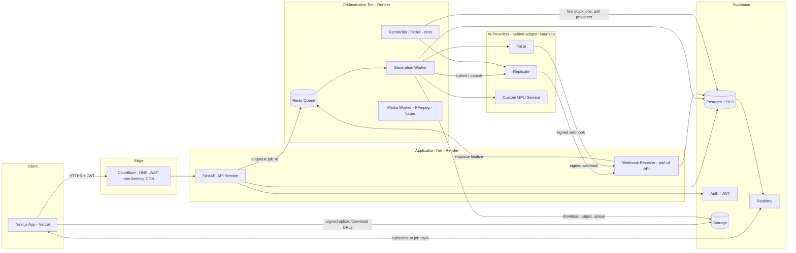
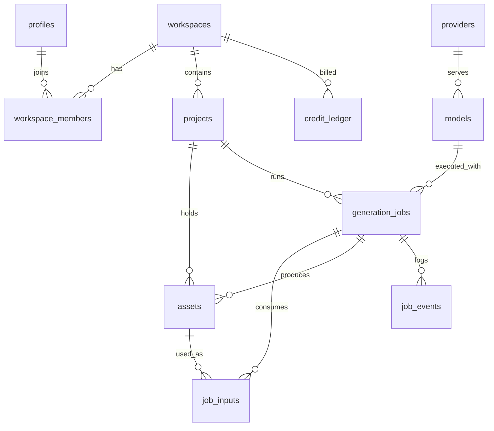
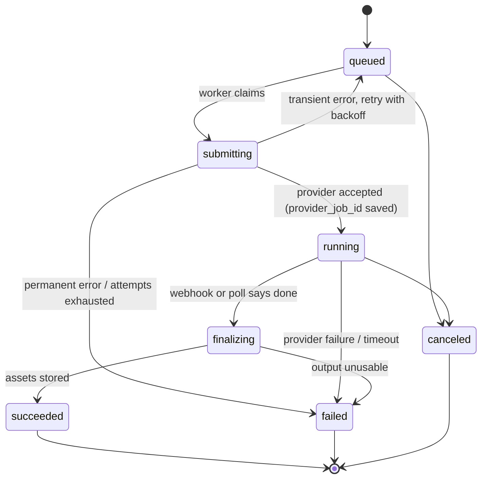
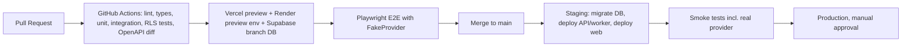

# AI Content Studio — Technical Design Document (MVP)

*Version 0.1 · Architecture for text/image/video generation with a path to stitching, editing and collaboration*

## 1. Goals, Scope and Key Decisions

**MVP flows:** Text→Image, Image+Text→Image, Text→Video, Image→Video, Image+Text→Video, organized in **Projects** inside a **Workspace**.

**Design principles**

1. **Postgres is the source of truth.** Queues are transport only; every job's state lives in `generation_jobs`.
2. **The web API never runs inference or waits on it.** It validates, persists, enqueues, and returns `202 Accepted`.
3. **Providers are plugins.** One internal `GenerationProvider` interface; Replicate, Fal.ai, or a self-hosted GPU service are interchangeable adapters.
4. **We own our media.** Provider output URLs expire, so every result is copied into our own storage and registered as an `asset`.
5. **Lineage by default.** Every generated asset records the job, inputs and parameters that produced it. This is what makes later editing, stitching and re-runs possible.
6. **Build the seams now, the features later.** Timelines, render jobs and collaboration are designed into the schema/orchestrator as extension points but not implemented in the MVP.

**Key decisions**

| Concern | MVP choice | Scale-up path |
| --- | --- | --- |
| Frontend | Next.js on Vercel | Same; add edge caching |
| API | FastAPI on Render (Web Service) | Horizontal scaling, separate public/internal APIs |
| Queue | Redis (Render Key Value) + ARQ workers | Dedicated queues per job type, SQS/Cloud Tasks, or Temporal |
| Database / Auth | Supabase Postgres, Auth, RLS | Read replicas, pgBouncer, partitioning of events |
| Object storage | Supabase Storage | Cloudflare R2 behind a CDN (S3-compatible, no egress fees) |
| Inference | Replicate / Fal.ai via adapters | Self-hosted GPU workers (Modal, RunPod, Kubernetes) as another adapter |
| Realtime UI | Supabase Realtime on `generation_jobs` | Same; fall back to polling |
| Heavy media ops (later) | Render Background Worker with FFmpeg | GPU/CPU render fleet consuming a `render` queue |

## 2. System Architecture



**Request lifecycle (generation)**

1. UI calls `POST /v1/projects/{id}/generations` with an `Idempotency-Key`.
2. API authenticates (Supabase JWT), authorizes (workspace membership), validates params against the model's capability schema, reserves credits, inserts `generation_jobs` (`queued`) and `job_inputs`, enqueues `job_id`, and returns `202` with the job.
3. A worker claims the job, resolves input assets to short-lived signed URLs, and submits to the provider through the adapter, storing the provider's prediction ID and moving the job to `running`.
4. The provider calls our webhook on completion (the reconciler polls as a safety net). The webhook is verified, recorded, and a `finalize` task is enqueued.
5. The worker downloads the output, uploads it to our storage, generates a thumbnail/poster and metadata (dimensions, duration), creates `assets`, and marks the job `succeeded`.
6. Supabase Realtime pushes the row change to the browser, which shows the new asset in the project.

## 3. Database Schema (Supabase / PostgreSQL)

### 3.1 Entity overview



### 3.2 DDL (core MVP tables)

```sql
create extension if not exists pgcrypto;

-- Identity & tenancy ---------------------------------------------------
create table profiles (
  id            uuid primary key references auth.users on delete cascade,
  display_name  text,
  avatar_url    text,
  created_at    timestamptz not null default now()
);

create table workspaces (
  id          uuid primary key default gen_random_uuid(),
  name        text not null,
  owner_id    uuid not null references profiles(id),
  created_at  timestamptz not null default now()
);

create type workspace_role as enum ('owner','admin','editor','viewer');

create table workspace_members (
  workspace_id uuid references workspaces(id) on delete cascade,
  user_id      uuid references profiles(id) on delete cascade,
  role         workspace_role not null default 'editor',
  created_at   timestamptz not null default now(),
  primary key (workspace_id, user_id)
);

create table projects (
  id           uuid primary key default gen_random_uuid(),
  workspace_id uuid not null references workspaces(id) on delete cascade,
  name         text not null,
  description  text,
  cover_asset_id uuid,                    -- fk added after assets
  created_by   uuid not null references profiles(id),
  created_at   timestamptz not null default now(),
  updated_at   timestamptz not null default now(),
  archived_at  timestamptz
);
create index on projects (workspace_id, created_at desc) where archived_at is null;

-- Provider / model registry (data-driven, swappable) --------------------
create table providers (
  id       text primary key,              -- 'replicate','fal','custom_gpu'
  name     text not null,
  enabled  boolean not null default true
);

create table models (
  id               uuid primary key default gen_random_uuid(),
  provider_id      text not null references providers(id),
  provider_model   text not null,         -- e.g. provider's model slug/version
  slug             text unique not null,  -- internal stable name: 'img-fast-v1'
  display_name     text not null,
  task_type        text not null check (task_type in ('text_to_image','image_to_image','text_to_video','image_to_video')),
  input_schema     jsonb not null,        -- JSON Schema of accepted params
  default_params   jsonb not null default '{}',
  cost_credits     numeric(10,2) not null default 1,
  enabled          boolean not null default true,
  unique (provider_id, provider_model, task_type)
);

-- Media ------------------------------------------------------------------
create type asset_kind   as enum ('image','video','audio','other');
create type asset_origin as enum ('upload','generated','derived');

create table assets (
  id            uuid primary key default gen_random_uuid(),
  workspace_id  uuid not null references workspaces(id) on delete cascade,
  project_id    uuid not null references projects(id) on delete cascade,
  kind          asset_kind not null,
  origin        asset_origin not null,
  storage_bucket text not null default 'media',
  storage_path  text not null,            -- {workspace}/{project}/{asset}/original.ext
  thumbnail_path text,
  mime_type     text,
  size_bytes    bigint,
  width         int,
  height        int,
  duration_ms   int,
  fps           numeric(6,3),
  source_job_id uuid,                     -- lineage; fk added after jobs
  parent_asset_id uuid references assets(id), -- derived/edited-from
  metadata      jsonb not null default '{}',
  created_by    uuid references profiles(id),
  created_at    timestamptz not null default now(),
  deleted_at    timestamptz
);
create index on assets (project_id, created_at desc) where deleted_at is null;
create index on assets (source_job_id);

alter table projects add constraint projects_cover_fk
  foreign key (cover_asset_id) references assets(id) on delete set null;

-- Generation jobs --------------------------------------------------------
create type job_status as enum (
  'queued','submitting','running','finalizing','succeeded','failed','canceled'
);

create table generation_jobs (
  id               uuid primary key default gen_random_uuid(),
  workspace_id     uuid not null references workspaces(id) on delete cascade,
  project_id       uuid not null references projects(id) on delete cascade,
  created_by       uuid not null references profiles(id),
  model_id         uuid not null references models(id),
  task_type        text not null,
  status           job_status not null default 'queued',
  prompt           text,
  negative_prompt  text,
  params           jsonb not null default '{}',    -- validated, resolved params
  idempotency_key  text,
  provider_job_id  text,                            -- provider's prediction id
  attempt          int not null default 0,
  max_attempts     int not null default 3,
  error_code       text,
  error_message    text,
  cost_credits     numeric(10,2) not null default 0,
  parent_job_id    uuid references generation_jobs(id), -- re-runs / variations
  workflow_run_id  uuid,                            -- future: step in a workflow
  queued_at        timestamptz not null default now(),
  started_at       timestamptz,
  completed_at     timestamptz,
  heartbeat_at     timestamptz,
  unique (workspace_id, idempotency_key)
);
create index on generation_jobs (project_id, queued_at desc);
create index on generation_jobs (status, heartbeat_at) where status in ('submitting','running','finalizing');
create unique index on generation_jobs (provider_job_id) where provider_job_id is not null;

alter table assets add constraint assets_source_job_fk
  foreign key (source_job_id) references generation_jobs(id) on delete set null;

create type input_role as enum ('init_image','reference_image','first_frame','last_frame','mask','audio','video');

create table job_inputs (
  job_id    uuid references generation_jobs(id) on delete cascade,
  asset_id  uuid references assets(id),
  role      input_role not null,
  position  int not null default 0,
  primary key (job_id, asset_id, role)
);

-- Append-only audit/debug log (webhooks, state changes, provider payloads)
create table job_events (
  id         bigint generated always as identity primary key,
  job_id     uuid not null references generation_jobs(id) on delete cascade,
  type       text not null,          -- 'state_change','webhook','retry','error','poll'
  from_status job_status,
  to_status   job_status,
  payload    jsonb,
  created_at timestamptz not null default now()
);
create index on job_events (job_id, id);

-- Usage / credits (append-only ledger) -----------------------------------
create table credit_ledger (
  id           bigint generated always as identity primary key,
  workspace_id uuid not null references workspaces(id),
  job_id       uuid references generation_jobs(id),
  delta        numeric(10,2) not null,          -- negative = reserve/spend
  reason       text not null,                   -- 'reserve','refund','purchase','grant'
  created_at   timestamptz not null default now()
);
```

### 3.3 Row-Level Security

```sql
create function is_member(ws uuid, min_role workspace_role default 'viewer')
returns boolean language sql stable security definer as $$
  select exists (
    select 1 from workspace_members m
    where m.workspace_id = ws and m.user_id = auth.uid()
      and m.role <= min_role      -- enum order: owner < admin < editor < viewer
  );
$$;

alter table projects        enable row level security;
alter table assets          enable row level security;
alter table generation_jobs enable row level security;

create policy proj_read  on projects for select using (is_member(workspace_id));
create policy proj_write on projects for all    using (is_member(workspace_id,'editor'))
                                          with check (is_member(workspace_id,'editor'));
create policy asset_read on assets for select using (is_member(workspace_id));
create policy job_read   on generation_jobs for select using (is_member(workspace_id));
-- Writes to generation_jobs, assets (generated), job_events and credit_ledger go
-- through the API/worker using the service role; clients get read access + Realtime.
```

**Storage layout:** private bucket `media`, path `{workspace_id}/{project_id}/{asset_id}/{filename}`. Storage policies mirror `is_member()` on the first path segment. The browser uploads directly via signed upload URLs, and downloads via short-lived signed URLs (or a Cloudflare-fronted URL later).

### 3.4 Extension tables (designed now, created later)

`workflows`, `workflow_runs`, `workflow_steps` (DAG of jobs), `timelines`, `tracks`, `clips` (asset reference + in/out points + transform), `render_jobs`, `comments`, `asset_versions`. The MVP columns `parent_job_id`, `workflow_run_id`, `parent_asset_id` and `source_job_id` already anchor these.

## 4. API Design

REST over JSON, versioned under `/v1`, authenticated with the Supabase JWT (`Authorization: Bearer`). The OpenAPI spec is generated by FastAPI and is the contract for the generated TypeScript client.

### 4.1 Projects and assets

| Method | Path | Purpose |
| --- | --- | --- |
| GET | `/v1/workspaces` | Workspaces for current user |
| POST | `/v1/workspaces/{ws}/projects` | Create project |
| GET | `/v1/workspaces/{ws}/projects` | List (cursor pagination) |
| GET / PATCH / DELETE | `/v1/projects/{id}` | Read, rename, archive |
| GET | `/v1/projects/{id}/assets?kind=&origin=&cursor=` | List assets |
| POST | `/v1/projects/{id}/assets/uploads` | Returns signed upload URL + draft asset id |
| POST | `/v1/assets/{id}/complete` | Confirm upload; server extracts metadata and thumbnail |
| GET | `/v1/assets/{id}` | Asset with signed URLs and lineage |
| DELETE | `/v1/assets/{id}` | Soft delete |

### 4.2 Generation

| Method | Path | Purpose |
| --- | --- | --- |
| GET | `/v1/models?task_type=` | Available models plus parameter JSON Schemas (drives UI forms) |
| POST | `/v1/projects/{id}/generations` | Submit job (`202`) |
| GET | `/v1/generations/{id}` | Job status, outputs, error |
| GET | `/v1/projects/{id}/generations?status=` | Job history |
| POST | `/v1/generations/{id}/cancel` | Cancel if not terminal |
| POST | `/v1/generations/{id}/retry` | New attempt or new job with same inputs |
| GET | `/v1/generations/{id}/events` | Debug timeline (admin/owner) |

**Submit request**

```json
POST /v1/projects/8f1c.../generations
Idempotency-Key: 7c9e6679-7425-40de-944b-e07fc1f90ae7
{
  "model": "img-fast-v1",
  "task_type": "image_to_video",
  "prompt": "slow dolly-in, golden hour, soft film grain",
  "inputs": [{"asset_id": "a41b...", "role": "first_frame"}],
  "params": {"duration_s": 5, "aspect_ratio": "16:9", "seed": 42}
}
```

**Response `202 Accepted`**

```json
{
  "id": "c3d2...",
  "status": "queued",
  "task_type": "image_to_video",
  "queued_at": "2026-10-16T09:14:22Z",
  "outputs": [],
  "links": {"self": "/v1/generations/c3d2..."}
}
```

**Validation rules:** `task_type` must match the model; required input roles are enforced per task (e.g. `image_to_video` needs `first_frame`); params are validated against `models.input_schema`; input assets must belong to the same workspace; insufficient credits returns `402`.

### 4.3 Webhooks and status delivery

- **Inbound provider webhook:** `POST /internal/webhooks/{provider}/{job_id}?token=...` verifies the provider signature (HMAC) plus a per-job token, stores the payload in `job_events`, returns `200` quickly, and enqueues a `finalize` task. It is idempotent: duplicate deliveries are no-ops when the job is already terminal.
- **Client updates:** primary is Supabase Realtime subscription on `generation_jobs` filtered by `project_id`; fallback is polling `GET /v1/generations/{id}` with backoff (2s → 10s).
- **Outbound webhooks (later):** `POST` to customer URLs on `generation.succeeded` / `generation.failed`, signed, with retries.

### 4.4 Conventions

Cursor pagination, RFC 7807 problem-details errors with stable `error_code`s, `Idempotency-Key` on all job-creating POSTs, request IDs propagated to workers and logs, and per-user/workspace rate limits (Cloudflare edge plus Redis token bucket in the API).

## 5. Task Orchestration Strategy

### 5.1 Pattern

The API is a thin **producer**; **workers** are consumers. They share the same Python package (`studio_core`) but deploy as separate Render services, so each scales and fails independently.

- **Queue:** Redis with **ARQ** (async-native, which fits I/O-bound provider calls). Celery is a valid alternative if the team already knows it; the design only depends on the `enqueue(task, job_id)` abstraction.
- **Tasks carry only IDs.** Workers re-read state from Postgres, which makes tasks safe to retry and avoids stale payloads.
- **Queues by class of work:** `generation` (provider calls), `finalize` (download, store, thumbnail), `maintenance` (reconciler), and later `render` (FFmpeg) and `gpu`. Separate queues stop slow video renders from starving image jobs.

### 5.2 Job state machine



Transitions are performed with a guarded update (`update ... set status=$new where id=$id and status=$expected returning *`), so concurrent webhook/poll/worker paths cannot corrupt state. Every transition appends a `job_events` row.

### 5.3 Reliability mechanisms

| Risk | Mitigation |
| --- | --- |
| Duplicate submissions (double-click, client retry) | `Idempotency-Key` plus unique `(workspace_id, idempotency_key)` |
| Worker crashes mid-job | `heartbeat_at` plus the reconciler re-enqueues or polls jobs stuck in `submitting`/`running`/`finalizing` past a threshold |
| Lost or late webhooks | Reconciler cron (every 30–60s) polls provider status for jobs `running` longer than expected |
| Duplicate provider submission on retry | Check `provider_job_id` before submitting; pass our `job_id` as provider metadata where supported |
| Transient provider errors / 429s | Exponential backoff with jitter, per-provider concurrency limits and circuit breaker |
| Poison jobs | `max_attempts`, then `failed` with `error_code`, credit refund via ledger |
| Expiring provider URLs | `finalize` copies outputs to our storage immediately, with checksum and size recorded |
| Runaway cost | Reserve credits at submit, refund on failure, per-workspace concurrent job cap |
| Redis data loss | Redis is disposable: on boot, the reconciler re-enqueues all `queued` rows from Postgres |

### 5.4 Provider abstraction

```python
class GenerationProvider(Protocol):
    id: str

    async def submit(self, req: ProviderRequest) -> ProviderJobRef: ...
    async def get_status(self, ref: ProviderJobRef) -> ProviderStatus: ...
    async def cancel(self, ref: ProviderJobRef) -> None: ...
    def verify_webhook(self, headers: Mapping, body: bytes) -> WebhookEvent: ...
    def normalize_output(self, raw: dict) -> list[ProviderOutput]: ...


# Registry: provider_id -> adapter instance; chosen via models.provider_id
# Adapters: ReplicateProvider, FalProvider, CustomGpuProvider (HTTP + same contract)
```

The internal `ProviderRequest` is provider-neutral (task type, prompt, resolved input URLs, params); each adapter maps it to its provider's schema. Capabilities (max duration, supported aspect ratios) live in `models.input_schema`, so adding a model is a database row plus, at most, a small mapper.

### 5.5 Scaling to GPU-bound and long-running work

Because the worker only speaks the adapter interface, moving to your own GPUs means writing a `CustomGpuProvider` that submits to a GPU service (Modal, RunPod, or a Kubernetes job runner) and reports back via the same webhook path. The API, schema, and UI do not change. For multi-step workflows, introduce a durable workflow engine (Temporal, or Postgres-backed DAG execution) in front of the same adapters.

## 6. Modular Component Plan and Roadmap

### 6.1 Code organization (monorepo)

```text
/apps
  /web                 Next.js (App Router, TS)
  /api                 FastAPI app (routers only; thin)
  /worker              ARQ worker entrypoints
/packages
  /studio_core         domain models, services, state machine, repositories
  /studio_providers    adapters + registry
  /studio_media        FFmpeg/thumbnail/metadata utilities (used by finalize now, render later)
  /api-client          generated TS client from OpenAPI
  /ui                  shared React components
/infra                 render.yaml, supabase migrations, GitHub Actions
/docs                  ADRs, runbooks, API docs
```

**Boundary rule:** `api` and `worker` both depend on `studio_core`; neither imports the other. This is the seam that lets the orchestrator move to a different runtime or host.

### 6.2 Phased roadmap

| Phase | Capability | Key additions |
| --- | --- | --- |
| **0 – MVP** | All five generation flows, projects, asset library, history, credits | Tables in §3.2, `generation` and `finalize` queues, one or two providers, Realtime status |
| **1 – Hardening** | Variations, re-run with edits, favorites, batch generation (n outputs), usage dashboard | `parent_job_id` UX, multi-output jobs, per-model cost tracking, observability |
| **2 – Workflows** | Chained steps (e.g. image → video → upscale), saved presets/templates | `workflows`, `workflow_runs`, `workflow_steps` DAG; step outputs wired to step inputs by asset ID |
| **3 – Stitching and editing** | Timeline with clips, trim, transitions, audio, export | `timelines`, `tracks`, `clips`, `render_jobs`; `render` queue and FFmpeg media workers; timeline JSON as an edit-decision list (non-destructive); proxy/preview renditions via HLS |
| **4 – Collaboration** | Multi-user projects, comments, presence, review/approval | Roles already in `workspace_members`; `comments`; Supabase Realtime presence; optimistic concurrency (versioned timelines, later CRDT/Yjs if needed) |
| **5 – Scale-out** | Self-hosted models, dedicated GPU pools, CDN delivery | `CustomGpuProvider`, R2 storage with Cloudflare CDN, queue per GPU class, autoscaling workers, optional Temporal |

### 6.3 Design notes for Phase 3 (so MVP choices do not block it)

- Assets carry `duration_ms`, `fps`, `width`, `height` from day one, which a timeline editor needs.
- A timeline is non-destructive data (clips referencing assets); exports produce a new `derived` asset with `parent_asset_id` lineage and a `render_jobs` row that reuses the same state machine and job events.
- The `render` worker reuses `studio_media`; no extra service is required until volume demands it.

## 7. Development Standards

### 7.1 Testing strategy

| Layer | Tooling | What it covers |
| --- | --- | --- |
| Unit (Python) | `pytest`, `pytest-asyncio`, `hypothesis` | State machine transitions, param validation, credit math, adapter mapping |
| Provider contract tests | `pytest` + recorded fixtures (`vcrpy` / `respx`) | Each adapter against the `GenerationProvider` contract; one fake provider used across all other tests |
| Integration | `pytest` with Supabase local stack (`supabase start`) and Redis in Docker/Testcontainers | API → DB → queue → worker → fake provider → asset, including webhook replay and duplicate delivery |
| RLS tests | pgTAP or SQL tests via `supabase test db` | Cross-workspace isolation; viewer vs editor permissions |
| Frontend unit/component | Vitest, React Testing Library, MSW | Forms driven by model schemas, job status UI |
| End-to-end | Playwright against preview deployments with a fake provider | Sign in → create project → generate → asset appears |
| Load / resilience | k6 or Locust; chaos cases (kill worker, drop webhooks) | Reconciler recovery, queue backpressure |
| Static analysis | `ruff`, `mypy --strict`, ESLint, `tsc --noEmit`, `bandit` | Type safety and security linting |

A **FakeProvider** (configurable latency, failure injection, deterministic outputs) is a first-class component: it enables fast CI, local development without spending credits, and E2E tests. Real providers run in a small nightly smoke suite only.

### 7.2 Documentation

- **API:** FastAPI auto-generated OpenAPI/Swagger (`/docs`, `/redoc`); spec exported in CI and used to generate `/packages/api-client` (`openapi-typescript`). CI fails on unreviewed breaking spec changes (`oasdiff`).
- **Architecture:** ADRs in `/docs/adr` (e.g. *ADR-001 Postgres as job source of truth*, *ADR-002 ARQ vs Celery*), diagrams as Mermaid in-repo.
- **Runbooks:** stuck jobs, provider outage, webhook replay, credit reconciliation.
- **Database:** migrations are the documentation (Supabase CLI), plus generated schema docs and typed models (`supabase gen types`).

### 7.3 CI/CD and environments



- **Environments:** local (Supabase CLI + Docker Compose with Redis), preview per PR, staging, production. Separate Supabase projects for staging and production.
- **Deploy order:** run migrations first (expand), deploy API and worker, then web; remove old columns only in a later release (contract). Workers drain gracefully on `SIGTERM` and unfinished jobs are picked up by the reconciler.
- **Infrastructure as code:** `render.yaml` blueprint (web service, worker, cron, Redis), Vercel project config, Cloudflare DNS/WAF rules (Terraform optional later).
- **Secrets:** provider keys, Supabase service role key and webhook secrets live in Render/Vercel environment groups only; the service-role key is never exposed to the browser.
- **Observability:** structured JSON logs with `request_id` and `job_id`; Sentry (API, worker, web); metrics for queue depth, time-in-state per status, provider latency/error rate, cost per job; alerts on stuck jobs and failure-rate spikes. OpenTelemetry traces from API through worker add depth later.

### 7.4 Security and operations checklist

- Validate and size-limit uploads (MIME sniffing, max dimensions/duration); virus-scan hook point in `assets/complete`.
- Prompt/output moderation hook inside the `generation` task before submit and in `finalize` (provider-agnostic).
- Signed, expiring URLs for all media; no public buckets.
- Per-workspace quotas and concurrency caps; per-IP and per-user rate limits at Cloudflare.
- Webhook signature verification plus per-job tokens; replay-safe handlers.
- Data retention policy for `job_events` (partition by month; archive after 90 days).

## 8. MVP Build Order (suggested)

1. Supabase schema, RLS and storage policies; auth wiring in Next.js and FastAPI.
2. `studio_core` state machine plus `FakeProvider`; `generations` endpoints; worker with `generation` and `finalize` tasks.
3. Projects and asset library UI with direct uploads and Realtime job status.
4. First real adapter (Replicate or Fal.ai) with webhook plus reconciler; text→image and image→image live.
5. Video models (text→video, image→video) with longer timeouts, poster frames, and video player UI.
6. Credits ledger, quotas, observability, staging environment and runbooks, then launch.
